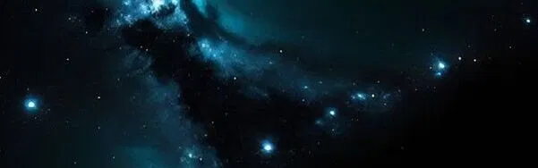

  

# hi! i'm Pragya Punia𖡼

[⋆⋆i be sleeping or eating or coding or creating⋆⋆ ]

 

## 01 · ⛧About me⛧

i am currently pursuing a B.Tech in computer science and engineering. iam interested in how technology translates into real-world products, businesses, and solutions and have been also exploring product development, growth strategy, partnerships, and community building. 
in short, iam a programmer with a fascination for how computers work. if you want to see what goes on in my pastime, please check my recent repositories. 
i'm particularly interested in opportunities across technology, product, growth, developer relations, and early-stage startups.

 

 

## 02 · my repo galaxy .𖥔 ݁ ˖

<picture>
  <source media="(prefers-color-scheme: dark)" srcset="assets/galaxy.svg?v=20261122">
  <source media="(prefers-color-scheme: light)" srcset="assets/galaxy-light.svg?v=20261122">
  
</picture>

planet size = commits this year · color = main language · little stars = commits · rebuilt every night

<!-- PLANETS:START -->

<a href="https://github.com/pragyaonherlaptop/chesstrel"><b>chesstrel</b></a> · 37 commits · C++ 
<a href="https://github.com/pragyaonherlaptop/hananinatte"><b>hananinatte</b></a> · 24 commits · C

<!-- PLANETS:END -->

 

## 03 · my tech stack ⋆⋆✴︎˚｡⋆

<picture>
  <source media="(prefers-color-scheme: dark)" srcset="assets/darkconstellations.svg">
  <source media="(prefers-color-scheme: light)" srcset="assets/lightconstellations.svg">
  
</picture>

 

**thanks for visiting** ✦

<pre>
⠀⠀⠀⠠⠀⠀⠀⠀⠀⠀⠀⠀⠀⠀⠀⠀⠀⠀⠀⠀⠀⠀⠀⠀⠀⠀⠀⠀⠀⠀⠀⠀⠀⠀⠀⠀⠀⠀⠀⠀⠀⠀⠀⠀⠀⠀⠀⠀⠀⠀⠀⠀⠀⠀⠀⠀⠀⠀⠀⠀⠀⠀⠀⠀
⠁⠀⠀⠀⠀⠀⠀⠀⠀⠀⠀⠀⠀⠀⠀⠀⠀⠀⠀⠀⠀⠀⠀⠀⠀⠀⠀⠀⠀⠀⠀⠀⠀⠄⠀⠀⠀⠀⠀⠀⠀⠀⠀⠀⠀⠀⠀⠀⠀⠀⠄⠀⠀⠀⠀⠀⠀⠀⠀⠀⠀⠀⠀⠀
⠀⠁⠀⢀⠀⠀⠀⠀⠀⠀⠀⠀⠀⠀⠀⠀⠀⠀⠀⠀⠀⠀⠀⠀⠀⠀⠀⡀⠀⠀⠀⠀⠀⠀⠄⠀⠀⠀⠂⠀⠀⠀⠈⠀⠀⠀⠀⠀⠀⠀⠀⠀⠀⠀⠀⠀⠀⠀⠀⠀⠀⠀⠀⠀
⢀⠀⠀⠀⠀⠀⠀⠀⠀⠀⠀⠀⠀⠀⠀⠀⠀⠀⠁⠀⠀⠀⠀⠀⠀⠈⠀⠀⠀⠀⠀⠀⠀⠀⠀⠀⠀⠀⠀⠀⠀⠀⠀⠀⠀⠀⠀⠀⠀⠀⠀⠀⠀⠀⠀⠀⠀⠀⠀⠀⠀⠀⠀⠀
⠀⠠⠀⠀⠀⠀⠀⠀⠀⠀⠀⠀⠀⠀⠀⠀⠀⠀⠀⠀⠀⠀⠀⠀⠀⠀⠀⠀⠀⠀⠀⠀⠀⠀⠀⠀⠀⠀⠀⠀⠀⠀⠀⠀⠀⠀⠀⠀⠀⠀⠐⠀⠀⠀⠀⠀⠀⠀⠀⠀⠀⠀⠀⠀
⠀⠄⠀⠀⠀⠀⠂⠀⠀⠀⠀⠀⠀⠂⠀⠀⠀⠀⠀⠀⠀⠀⠀⠀⡀⠀⣷⠀⠀⠀⠀⠀⠀⠀⠀⠀⠀⠀⣾⠅⠀⠀⠀⠀⠀⠀⠀⠀⠀⠀⠀⠀⠀⠀⠀⠀⠀⠀⠀⠀⠀⠀⠀⠀
⠀⠀⠀⠀⠀⠀⠀⠀⠀⠀⠀⠀⠄⠀⠀⠀⠀⠀⠀⠀⠀⠀⡠⢴⡅⡠⠿⠶⢶⡶⠆⠀⠀⠀⠰⢾⡶⠶⠿⢤⢸⡧⢄⠀⠀⠀⢀⠀⠀⠀⠀⠀⠀⠀⠀⠀⠀⠀⠀⠀⠀⠀⠂⠀
⠄⠀⠀⠀⠀⠀⠀⠀⠀⠀⠀⠀⠀⠀⠀⠀⠀⠀⠀⠀⠀⠀⠉⡹⠋⢣⡦⢄⠀⠁⠀⠀⠀⠀⠀⠀⠁⢠⣄⡦⠙⢯⠉⠁⠀⠀⠀⠀⠀⠀⠀⠀⠀⠀⠀⠀⠀⠀⠀⠀⠀⠀⠀⠀
⠀⠀⠐⠀⠀⠀⠀⠀⠀⠀⠀⠀⠀⠀⣄⢀⠀⠀⠀⠀⠀⢠⣎⢱⠖⢻⢀⡟⠀⠀⠀⠀⠀⠀⠀⠀⠀⢻⡀⡜⠲⠮⢱⡄⠀⠀⠀⠀⠀⡀⡠⡀⠀⠀⠀⠀⠀⠀⠀⠀⠀⠀⠀⠀
⠈⠀⠀⠀⠀⠀⠀⠀⠀⠀⠀⠀⠀⢀⣉⢫⡴⢤⢔⢠⣠⠋⠙⠊⠀⠘⠊⠁⠀⠀⠀⠀⠀⠀⠀⠀⠀⠈⠑⠃⠀⠑⠋⠘⡆⡤⠂⢄⢶⡹⣏⡀⠀⠀⠀⠀⠀⠀⠀⠀⠀⠀⠠⠀
⠀⠂⠀⠀⠀⠀⠈⠀⠀⠀⠀⠀⠀⠀⠁⢻⢧⣇⠘⣭⣧⡄⠀⠀⠀⠀⠀⠀⠀⠀⠀⠀⠀⠀⠀⢀⠴⣄⠀⠀⠀⠀⠀⢠⣼⣌⠇⡸⡴⡙⠊⠀⠀⠀⠀⠀⠀⠀⠀⠀⠀⠀⠀⠀
⠀⠄⠀⠀⠀⠀⠀⠀⠀⠀⠀⠀⠀⠂⠀⠀⣱⡳⡅⡟⠥⠆⠀⠀⠀⠀⠀⠀⠀⠀⠀⠀⠄⠀⢀⡌⠀⠛⡂⠀⠀⠁⠀⠰⠮⢻⡈⣿⣊⠀⠀⠀⠀⠀⠀⠀⠀⠀⠀⠀⠀⠀⠀⠀
⡀⠀⠀⠀⠀⠀⠀⠀⠀⠀⠀⠀⠀⠀⠀⠀⠑⡇⣿⠁⠀⠀⠀⠀⠀⠀⠀⠀⠀⠀⠀⠀⠀⡰⠁⠸⡇⠰⡇⠀⠀⠀⠀⠀⠀⠈⣿⢸⠙⠀⠀⠀⠀⠀⠀⠀⠀⠀⠀⠀⠀⠀⠀⠀
⠀⠀⠀⠀⠀⠀⠀⠀⠀⠀⠀⠀⠀⡀⢠⠶⠀⢉⡏⠀⠀⠀⠀⠀⠀⠀⠀⠀⠀⠀⠀⠀⠀⣇⡀⠀⠀⠐⡇⠀⠀⠀⠀⠀⠀⠀⢸⡉⠀⢰⣀⠀⠀⠀⠀⠀⠀⠀⠀⠀⠀⠀⠀⠀
⠀⠁⠀⠀⠀⢀⠀⠀⠀⠀⠀⠀⠀⢀⢽⡁⠀⢸⠀⠀⠀⠀⠀⠀⠀⠀⠀⠀⠀⠀⠀⣠⠞⠉⠁⣰⡄⠀⠸⡂⠀⠀⠀⠀⠀⠀⠀⣇⠀⢈⡯⡀⠀⠀⠀⠀⠀⠀⠀⠀⠀⠀⠀⠀
⠀⠀⠀⠀⠀⠀⠀⠀⠀⠀⠀⠀⠀⠘⠁⢱⠀⡟⠀⠀⠀⠀⠀⠀⠀⠀⠀⠀⠀⠀⠘⠛⠒⠒⠊⢹⣾⡀⠀⡇⠀⠀⠀⠀⠀⠀⠀⢹⠀⡌⠈⠛⠀⠀⠀⠀⠀⠀⠀⠀⠀⠀⠀⠀
⠐⠀⠀⠀⠀⠀⠀⢀⠀⠀⠀⠀⠀⠀⠀⠈⡆⡇⠀⠀⠀⠀⠀⠀⠀⠀⠀⣀⣀⣀⡀⠀⢀⣀⣤⢾⠏⠁⠀⢸⠀⠀⠀⠀⠀⠀⠀⢸⢰⠃⠀⠀⠀⠀⠀⠀⠀⠀⠀⠀⠀⠀⠀⠀
⠀⠄⠀⠀⠀⠀⠀⠀⠀⠀⠀⢀⣀⠀⠀⢀⢹⡇⠀⠀⠀⠀⠀⠀⢀⣴⣾⣴⣩⡂⠀⠍⡉⠁⠁⡀⠀⠀⣀⡜⠀⠀⠀⠀⠀⠀⠀⢸⡏⡄⠀⠀⣀⡀⠀⠀⠀⠀⠀⠀⠀⠀⠀⠀
⠀⡀⠀⠀⠀⠀⠀⠀⠀⠀⢠⢋⢤⢱⡀⠘⣼⡃⢀⡄⠀⠀⠀⣀⠯⠠⢮⠀⢴⣯⡁⠐⠋⠀⠀⠁⠀⠀⢸⠁⠀⠀⠀⠀⠀⢠⣀⠈⣧⠃⢀⡎⣵⡜⡆⠀⠀⠀⠀⠀⠀⠠⠀⠀
⠀⠀⠀⠀⠀⠀⠀⠀⠀⠀⠈⢆⡸⠸⡇⠀⢸⣀⡿⠁⠀⠀⠀⠀⡀⣶⣾⠀⠀⠁⠀⠀⠀⠀⠀⠀⠀⠰⢰⡀⠀⠀⠀⠀⠀⠀⣿⣀⡇⠀⢸⡷⠏⡰⠁⠀⠀⠀⠀⠀⠀⠀⠀⠀
⠀⠀⠀⠀⠀⠀⠀⠀⠀⠀⠀⠀⠀⢨⠇⠀⢸⠥⣆⠇⠀⠀⠀⠀⢱⡄⢸⡮⠀⠀⠀⣠⣄⠀⠀⠀⡀⠀⡜⠁⠀⠀⠀⠀⠀⠘⣸⠤⣏⠀⠸⡇⠀⠀⠀⠀⠀⠀⠀⡀⠀⠀⠀⠀
⠄⠀⠀⠀⠀⠀⠄⠈⠀⠀⠀⠀⡤⢫⠒⢤⢸⠄⠁⠀⠀⠀⠀⠀⠈⣦⣿⠏⠀⠀⣰⠿⠿⣴⣤⠌⠃⡎⠀⠀⠀⠀⠀⠀⠀⠀⠈⠀⡇⡠⠲⢽⢢⠀⠀⠀⠀⠀⠀⠀⠀⠀⠀⠀
⠀⢀⠀⠀⠈⠀⠀⠀⠀⠐⠀⢀⣬⣀⠀⡾⠀⡄⠀⠀⠀⠀⠀⠀⠀⢸⠟⠀⢀⠜⠁⠀⠀⢻⣿⡆⢰⠁⠀⠀⠀⠀⠀⠀⠀⠀⠀⢀⠇⡷⠀⣄⣁⡀⠀⠀⠀⠀⠀⠀⠀⠀⠀⡀
⠀⠀⠀⠀⠀⠀⠀⠀⠀⠀⠀⠉⣀⣈⣑⣎⣄⣇⠀⠀⠀⠀⠀⡀⠊⠀⢀⠔⠉⠀⠀⠀⠀⠈⣿⠗⢸⡀⠀⠀⠀⠀⠀⠀⠀⠀⠀⢸⣠⣴⣚⣁⣀⠉⠀⠀⠀⠀⠀⠀⠀⠀⠀⠀
⡀⠄⠀⠀⠀⠀⠀⠀⠀⠀⢠⡞⠁⠀⠀⠉⠻⣿⠀⠀⠀⠀⠀⠀⣇⠀⣧⠀⠀⠀⠀⠀⠀⠀⢸⡥⣌⠀⠀⠀⠀⠀⠀⠀⠀⠀⠀⣿⠟⠉⠀⠀⠈⢻⡄⠀⠀⠀⠀⠀⠀⠀⠀⠀
⠀⠀⠀⠀⠀⠀⠀⠀⠀⠀⡾⠂⠀⠀⠀⠀⠀⠙⡄⠀⠀⠀⠀⠀⢸⠀⣇⠀⠀⠀⠁⠀⠀⠀⢸⡇⡗⠀⠀⠀⠀⠀⠀⠀⠀⠀⢀⠏⠀⠀⠀⠀⠀⠀⢳⡀⠀⠀⠀⠀⠀⠁⠀⠀
⠀⠀⠀⠀⠀⠀⠀⠀⠀⠀⡇⠸⢱⠀⠀⠀⠀⠀⢳⠀⠀⠀⠀⠀⢸⡇⡇⠀⠀⠀⠀⠀⠀⠀⢐⡇⡃⠀⠀⠀⠀⠀⠀⠀⠀⠀⡸⠀⠀⠀⠀⠀⢮⠗⢸⠀⠀⠀⠀⠀⠀⠀⠀⠀
⠀⡀⠀⠀⠀⠀⠀⠐⠀⠀⠈⠓⠂⠀⠀⢀⢤⡇⠘⣅⠀⠀⠀⠀⣸⡇⠁⠀⠀⠀⠀⠀⠀⠀⠀⢳⢡⠀⠀⠀⠀⠀⠀⠀⠀⢰⠋⣰⡦⡀⠀⠀⠘⠒⠃⠀⠀⠀⠀⠀⠀⠀⠀⠀
⠀⠀⠀⠀⠀⠀⠀⠀⠀⠀⠀⠀⠀⠀⠀⠙⡙⡟⣵⠼⡀⠀⠀⠀⠘⠣⣼⡀⠀⠀⠀⠀⠀⠀⠀⠈⠛⠀⠀⠀⠀⠂⠀⠀⢀⠇⢪⢟⣣⠋⠀⠀⠀⠀⠀⠀⠀⠀⠀⠀⠀⠀⠀⠀
⠄⠐⠀⠀⠀⢀⠀⠀⠀⠀⠀⠀⠀⠀⠀⠀⢣⡓⠃⢀⢽⡀⣀⡀⠀⠀⠀⠀⠀⠀⠐⠀⠀⠀⠀⠀⠀⠀⠀⠀⠀⢀⣠⢀⡯⡀⠈⠚⡘⠀⠀⠀⠀⠀⠀⠀⠀⠀⠀⠀⠀⠀⠀⡀
⠀⠀⠀⠀⠀⠀⠀⠀⠀⠀⠀⠀⠀⠀⠀⠀⠈⠣⠤⢼⠕⠻⡼⠅⠀⠀⠀⠀⠀⠀⠀⠀⠀⠀⠀⠀⠀⠀⠀⠀⠈⠸⢳⠟⠚⡣⠤⠔⠁⠀⠀⠀⠀⠀⠀⠀⠀⠀⠀⠀⠀⠀⠀⠀
⠀⠐⠀⠀⠀⠀⠀⠀⠀⠀⠀⠀⠀⠀⠀⠀⠀⠀⣸⠏⠀⠀⠈⠢⣀⠀⠀⠀⠀⠀⠀⠀⠀⠀⠀⠀⠀⠀⠀⠀⣀⠴⠋⠀⠀⠘⣇⠀⠀⠀⠀⠀⠀⠀⠀⠀⠀⠀⠀⠀⠀⠀⡀⠀
⠐⠀⠀⠀⠀⠀⠀⠀⠀⠀⠀⠀⠀⠀⠀⠁⠀⠀⠩⡰⠀⠀⠀⠀⠈⠑⠒⠤⣤⠔⣟⠀⠀⠊⢙⠢⣤⠴⠒⠊⠀⠀⠀⠀⠀⢇⠕⠀⠀⠀⠀⠀⠀⠀⠀⠀⠀⠀⠀⠀⠀⠀⠀⠀
⠀⠀⠀⠀⠀⠀⠀⠀⠀⠀⠀⠀⠀⠀⠀⠀⠀⠀⠀⠀⠀⠀⠀⠀⠀⠀⠀⠸⠭⠛⢗⣸⠄⣆⡸⠋⠏⠝⠀⠀⠀⠀⠀⠀⠀⠀⠀⠀⠀⠀⠀⠀⠀⠀⠀⠀⠀⠐⠀⠀⠀⠀⠀⠀
⠀⠂⠀⠀⠀⠀⠀⠀⠀⠀⠁⠀⠀⠀⠀⠀⠀⠀⠀⠀⠀⠀⠀⠀⠀⠀⠀⠀⠀⠀⠀⠀⠀⠀⠀⠀⠀⠀⠀⠀⠀⠀⠀⠀⠀⠀⠀⠀⠀⠀⠀⠀⠀⠀⠀⠀⠀⠀⠀⠀⠀⠀⠀⠀
⠠⠀⠀⠀⠀⠀⠀⢀⠀⠀⠀⠀⠀⡀⠀⠀⠀⠀⠀⠀⠀⠀⠀⠀⠀⠀⠀⡀⠀⠀⠀⠀⠀⠀⠀⠀⠀⠀⠀⠀⠀⠀⠀⠀⠀⠀⠀⠀⠀⠄⠀⠂⠀⠀⠀⠀⠐⠀⠀⠀⠀⠀⠀⠀
⠀⠀⠀⠀⠀⠀⠀⠀⠀⠀⠀⠀⠀⠀⠀⠀⠀⠀⠀⠀⠀⠀⠀⠀⠀⠀⠀⠀⠀⠀⠀⠀⠀⠀⠀⠀⠀⠀⠀⠀⠀⠀⠀⠀⠀⠀⠀⠀⠀⠀⠀⠀⠀⠀⠀⠀⠀⠀⠀⠀⠀⠀⠀⠀
⠀⠁⠀⠀⠀⠀⠀⠀⠀⠀⠀⠀⠀⠀⠀⠀⠀⠀⠀⠀⠀⠀⠀⠀⠀⠀⠀⠀⠀⠀⠀⠀⠀⠀⠀⠀⠀⠀⠀⠀⠀⠀⠀⠀⠀⠀⠀⠀⠀⠀⠀⠀⠀⠀⠀⠀⠀⠀⠀⠀⠀⠀⠀⡀
⠄⠂⠐⠀⠀⠀⠀⠀⠀⠀⡀⠂⠀⠀⠀⠀⠀⠀⠀⠂⠀⠀⠀⠀⢀⠀⠀⠀⠀⠀⠀⢀⠀⠀⠀⠀⠀⢀⠀⠀⠀⠀⠀⠀⠀⠀⠀⠀⠀⠀⠀⠀⠀⠀⠀⠀⠀⠀⠀⠀⠀⠀⠀⠀
⣀⠀⠀⠀⠀⠀⠀⠀⠀⠀⠀⠀⠀⠂⠀⠀⠀⠀⠀⠀⠀⠈⠀⠀⠀⠀⠀⠀⠐⠀⠀⠀⠀⠀⠀⠀⠀⠀⡀⠀⠀⠀⠀⠀⠀⠀⠐⠀⠀⠀⠀⠀⠀⠀⠀⠀⠐⠀⠀⠀⠀⠀⠀⠀
</pre>

